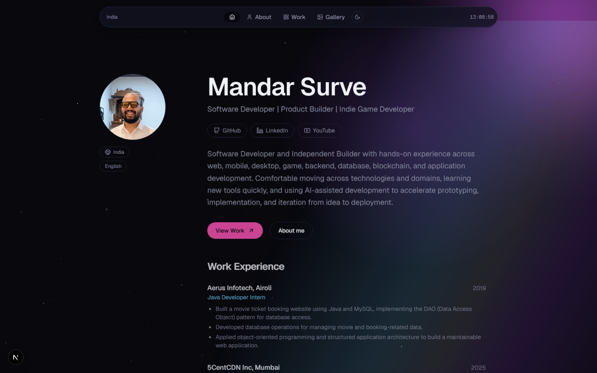
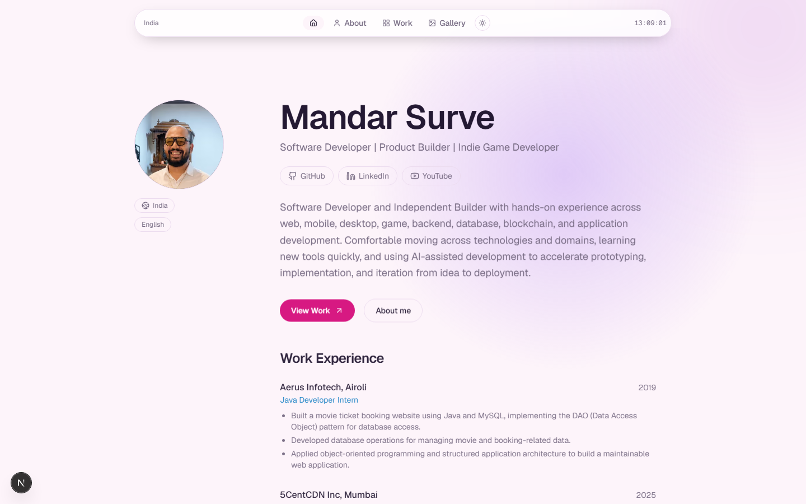
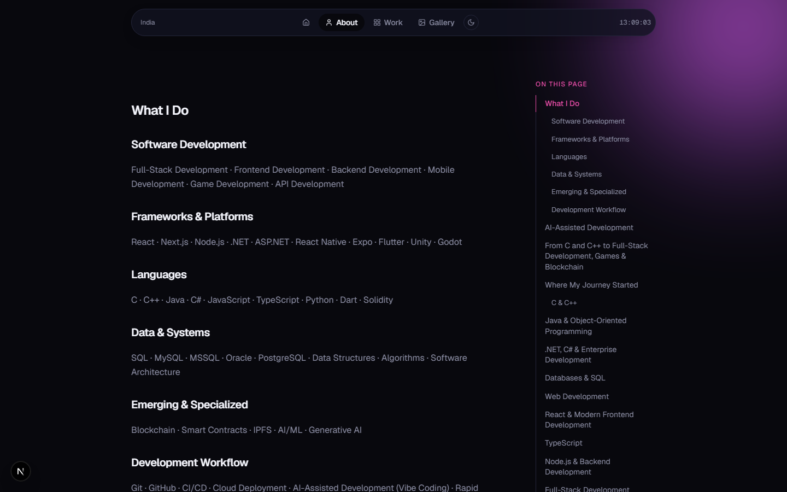
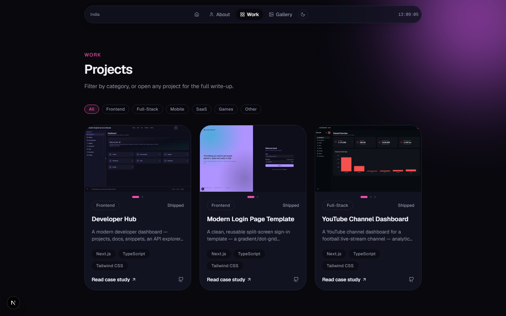
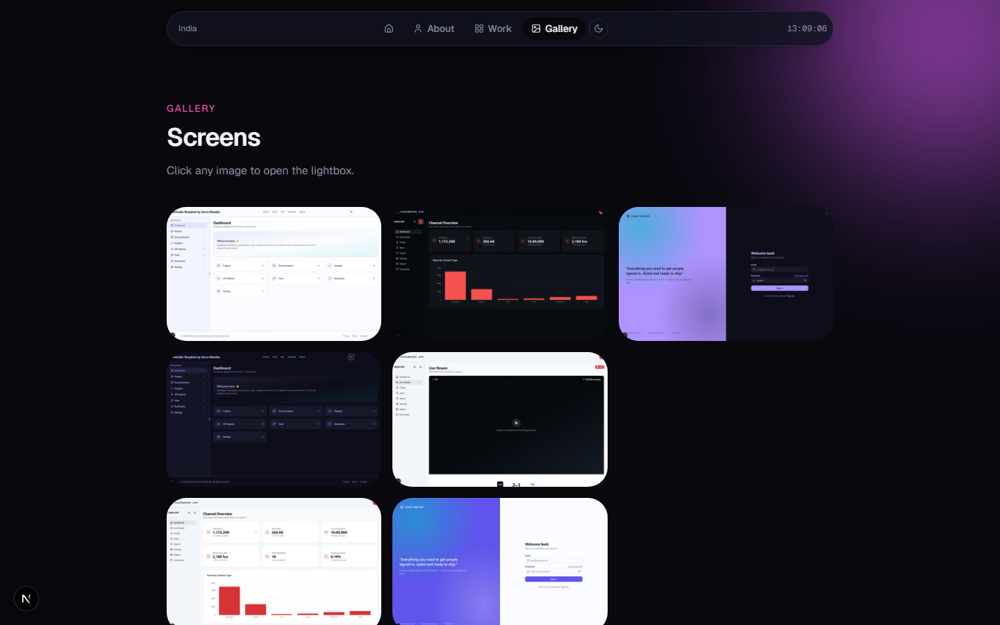

 <div align="center">

# 🎮 Mandar Surve — Game Development Portfolio

A personal portfolio built to document a journey into game development, showcase technical skills, and present creative work through a structured, media-rich website.

The portfolio combines a game-development-focused identity with a modern web architecture. It includes a dedicated game development journey, MDX-driven case studies, a filterable work section, a visual gallery, theme switching, and reusable interface components.

**Game Development · Unity · Real-Time VFX · Portfolio Engineering**

[](https://unity.com/)
[](https://learn.microsoft.com/en-us/dotnet/csharp/)
[](https://unity.com/)
[](https://godotengine.org/)

**Tools & Workflows**

[](https://docs.unity3d.com/Manual/urp/urp-introduction.html)
[](https://docs.unity3d.com/Manual/nav-BuildingNavMesh.html)
[](https://docs.unity3d.com/Manual/webgl.html)
[](https://krita.org/)
[](https://www.materialmaker.org/)

**Web Technologies**

[](https://nextjs.org)
[](https://react.dev)
[](https://www.typescriptlang.org)
[](https://tailwindcss.com)
[](https://mdxjs.com)

</div>

---

## 📸 Preview

The screenshots below show the portfolio's main pages and visual presentation.

<table>
<tr>
<td align="center" width="50%"><b>Home — Dark Theme</b><br/></td>
<td align="center" width="50%"><b>Home — Light Theme</b><br/></td>
</tr>
<tr>
<td align="center" width="50%"><b>About</b><br/></td>
<td align="center" width="50%"><b>Work</b><br/></td>
</tr>
<tr>
<td align="center" colspan="2"><b>Gallery</b><br/></td>
</tr>
</table>

## ✨ Features

- **Home page:** Profile introduction, featured work, experience timeline, and animated skills grouped by category.
- **Game Development Journey:** A dedicated page connecting gaming history, learning, game development, and real-time VFX.
- **About page:** Long-form MDX content with a scroll-spy table of contents that tracks the active section.
- **Work page:** Filterable project grid with individual MDX-driven case-study pages.
- **Gallery:** Masonry image layout with a keyboard-navigable lightbox.
- **Dark and light themes:** Theme-aware styling across the site, including the animated background.
- **Animated hero background:** Seeded starfield and cursor-reactive glow in dark mode, hidden in light mode.
- **Dynamic Open Graph images and favicon:** Generated using Next.js image-generation capabilities, reducing the need for static preview assets.
- **Reusable components:** Shared layouts and presentation components for easier maintenance and extension.
- **Context-menu and image-drag deterrents:** Basic client-side deterrents, not DRM or a guarantee against copying.

## 🏗️ Portfolio Architecture

The portfolio separates page routing, reusable UI components, content, configuration, and data-loading logic.

| Layer         | Responsibility                                                             |
| ------------- | -------------------------------------------------------------------------- |
| App Router    | Page routes, layouts, metadata, and route-specific rendering               |
| Components    | Reusable UI, navigation, hero, project cards, gallery, and theme controls  |
| MDX content   | Long-form narrative and project case studies                               |
| Configuration | Site identity, navigation, external links, and work-experience information |
| Data loaders  | Project, gallery, skills, and MDX content processing                       |
| Public assets | Screenshots, project imagery, and other static files                       |
| Styling       | Responsive layouts, theme variables, animations, and component styling     |

This structure makes it possible to change content and add projects without rebuilding the entire interface for every new entry.

## 🛠️ Tech Stack

| Technology                                                      | Purpose                                                            |
| --------------------------------------------------------------- | ------------------------------------------------------------------ |
| [Next.js 16](https://nextjs.org)                                | React framework, App Router, routing, and server-side capabilities |
| [React 19](https://react.dev)                                   | Component-based interface development                              |
| [TypeScript 5](https://www.typescriptlang.org)                  | Typed application code                                             |
| [Tailwind CSS v4](https://tailwindcss.com)                      | Utility-first styling and responsive layouts                       |
| [next-themes](https://github.com/pacocoursey/next-themes)       | Theme preference management                                        |
| [next-mdx-remote](https://github.com/hashicorp/next-mdx-remote) | MDX content rendering                                              |
| [rehype-pretty-code](https://rehype-pretty-code.netlify.app/)   | Code-block formatting                                              |
| [Shiki](https://shiki.style/)                                   | Syntax highlighting                                                |
| [Lucide](https://lucide.dev/)                                   | Interface icons                                                    |

### Why MDX?

MDX allows content to be maintained separately from page layout. Narrative sections and project case studies can be written as content files while the website controls how headings, text, images, and other supported elements are presented.

This makes the portfolio easier to extend: new case studies can follow a consistent content structure while sharing the same rendering and navigation system.

## 📂 Project Structure

```text
new-portfolio-site/
├── app/
│   ├── page.tsx                 # Home page
│   ├── about/                   # About page
│   ├── game-journey/            # Game development journey
│   ├── work/                    # Work listing and project routes
│   ├── gallery/                 # Gallery page
│   └── ...                      # Metadata and generated routes
├── components/
│   ├── hero/                    # Profile, experience, skills, featured work
│   ├── about/                   # About and journey components
│   ├── projects/                # Project cards and image carousel
│   ├── gallery/                 # Masonry layout and lightbox
│   └── layout/                  # Header, footer, themes, background
├── content/                     # MDX content and case studies
├── config/
│   └── site.ts                  # Site configuration and navigation
├── lib/                          # Content processing and data loaders
├── public/
│   └── images/                  # Static images and screenshots
├── .github/
│   └── screenshots/             # README preview screenshots
├── package.json
└── ...
```

_This is a high-level overview. Check the repository for the exact current filenames and route structure._

## 🚀 Installation & Setup

### Prerequisites

- Node.js compatible with the installed Next.js version
- npm
- Git

### 1. Clone the repository

```bash
git clone https://github.com/Fawkes73/new-portfolio-site.git
cd new-portfolio-site
```

### 2. Install dependencies

```bash
npm install
```

### 3. Start the development server

```bash
npm run dev
```

Open [http://localhost:3000](http://localhost:3000).

### 4. Create a production build

```bash
npm run build
npm run start
```

## 🧩 Adapting the Portfolio

To reuse this structure for another personal portfolio:

1. **Update the site configuration.** Change the name, navigation, social links, and work-experience information in `config/site.ts`.
2. **Replace the content.** Update the MDX files in `content/` with your own journey and project case studies.
3. **Replace the imagery.** Add your own screenshots and artwork under `public/images/`, then update the corresponding content and image references.
4. **Update the skills and project data.** Keep the categories and metadata consistent with the loaders and components used by the site.
5. **Customise the visual identity.** Adjust theme variables, typography, spacing, and the hero presentation to suit your work.
6. **Validate every route.** Run the development server and production build to check links, images, content rendering, and responsive behaviour.

Before publishing a fork, replace the original profile details, social links, project assets, and any personal content with your own.

## 🔗 Connect

- **GitHub:** [@Fawkes73](https://github.com/Fawkes73)
- **YouTube:** [Channel](https://www.youtube.com/@codingmarathiyt)
- **Portfolio:** [mandar-surve-portfolio-2026.vercel.app](https://mandar-surve-portfolio-2026.vercel.app)

---

<div align="center">

_Built to document the journey of learning, experimenting, and creating games._

</div>
